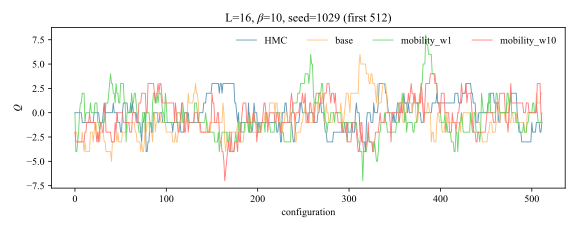
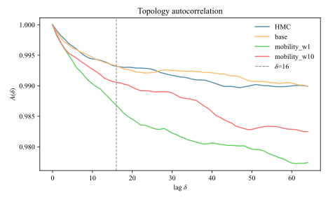
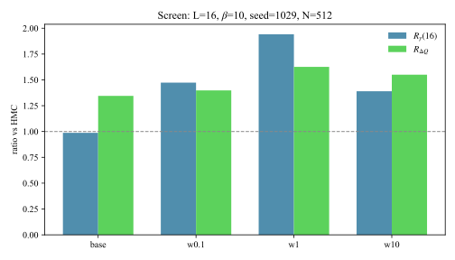
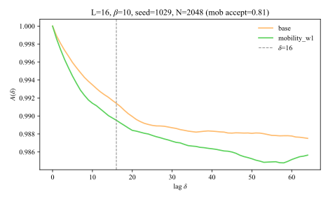
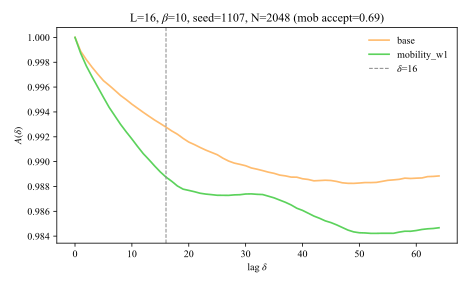
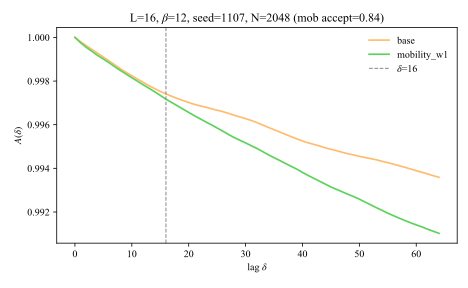
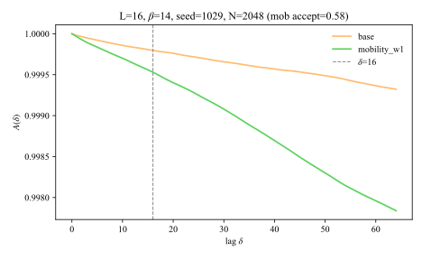
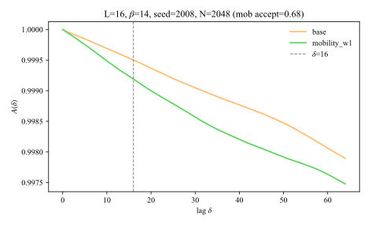

# U(2) Topology-Directed Loss Experiments

This note records why force-topology alignment was rejected, the phase-topology
mobility experiment that replaced it, and the decision to adopt
`mobility_weight=1` as the U(2) training default. The comparison workspace
`2du2/evaluation/alignment` has been removed; the numbered results below remain
the historical evidence. Production `evaluation/base` dumps are still the
force-only grid until the next default-protocol retrain.

## Soft topology proxy

Both experiments use the differentiable determinant-phase proxy

```text
Q_soft = sum(sin(theta) + 0.3 sin(2 theta)) / (2 pi).
```

It is implemented in `src/nthmc/u2/training.py`. It is a training proxy, not the
integer topology observable used to score FT-HMC chains.

## Rejected force-alignment objective

The old objective was

```text
force loss - align_weight * mean(cos(force, grad Q_soft)^2).
```

The square was present and rewarded alignment and anti-alignment equally. Older
L=32 short ablations tested `cos_sq`, smooth absolute cosine, and hinge losses.
None robustly beat force-only, and large weights weakened force-loss training.

The stable L=16, beta=10, seed=1029 rerun confirmed this result with full 16-epoch
training from the same initialization:

| align weight | best epoch | best validation force loss | fixed-probe cos^2 |
| ---: | ---: | ---: | ---: |
| 0 | 10 | 28.3523 | 0.003586 |
| 1 | 10 | 28.3653 | 0.003573 |
| 10 | 10 | 28.4737 | 0.003477 |
| 30 | 10 | 28.6145 | 0.003308 |

All runs retained healthy inverse convergence, but increasing alignment weight
monotonically worsened validation force loss and did not increase the fixed-probe
alignment. The obsolete FT-HMC probes for these checkpoints were cancelled.

### Why the target was wrong

The transformed force is the effective-action gradient, not the HMC momentum.
Rewarding a force component along `grad Q_soft` can steepen the topology
direction rather than make random Gaussian momentum move farther along it.
Cosine is also scale-invariant and is only a local direction proxy.

Force-topology cosine remains useful as a diagnostic in
`src/nthmc/u2/training_diagnostics.py`, but it is no longer a training term.

## Phase-topology mobility objective

Let `z` be the FT-HMC coordinate, `U = T(z)`, and `p` its Gaussian momentum.
Then

```text
dQ_soft/dt = grad_z Q_soft(T(z)) dot p
E_p[(dQ_soft/dt)^2] = ||grad_z Q_soft(T(z))||^2.
```

The new objective therefore changes the momentum-induced topology mobility
instead of aligning the effective force. This first controlled test uses only
the central phase algebra component:

```text
M_transformed = ||grad_z,phase Q_soft(T(z))||^2 / V
M_physical    = ||grad_U,phase Q_soft(U)||^2 / V
r             = (M_transformed + eps) / (M_physical + eps)
reward        = r / (1 + r) - 1/2
loss          = force loss - mobility_weight * reward.
```

The physical mobility makes the quantity dimensionless. The bounded reward is
zero for the identity transform and cannot be increased without limit by simply
rescaling the transformation Jacobian.

The U(2) training default is now `mobility_weight=1`. Setting the weight to 0
preserves the force-only path and skips the extra topology autograd work.
Scheduler, early stopping, and checkpoint selection use validation force loss.

## Test protocol

The first screen uses L=16, train beta=10, seed 1029, the stable base training
settings, and `mobility_weight` values 0.1, 1, and 10. The completed force-only
weight-0 checkpoint is the matched control.

A candidate advances to FT-HMC only if:

1. validation force loss is within 5% of the control;
2. fixed-probe phase mobility ratio and reward increase;
3. inverse convergence and coefficient saturation remain healthy.

Promoted candidates are evaluated after a step-size probe using acceptance,
`R_gamma(16)`, and `R_deltaQ`. No topology benefit is claimed until multi-seed
chain-level measurements complete.

## L16 beta=10 seed=1029 weight screen

Training diagnostics on the shared seed-1029 initialization (best validation
force loss; control is `align_w0` / mobility weight 0):

| mobility weight | best epoch | best val force loss | vs control |
| ---: | ---: | ---: | ---: |
| 0 (control) | 10 | 28.3523 | — |
| 0.1 | 10 | 28.3572 | +0.02% |
| 1 | 10 | 28.5105 | +0.56% |
| 10 | 10 | 28.9158 | +2.0% |

All three weights stay within the 5% force-loss gate. FT-HMC screen used fixed
`ft_step_size=0.15625` after short acceptance probes; 512 configs, 10 leapfrog
steps. Relative metrics are versus matched HMC; production `base` is the
force-only FT-HMC reference. Chains were truncated to 512 samples for a fair
overlay.

| run | accept | R_gamma(16) | R_deltaQ |
| ---: | ---: | ---: | ---: |
| production base | — | 0.987 | 1.345 |
| mobility_w0.1 | 0.816 | 1.473 | 1.398 |
| mobility_w1 | 0.807 | 1.941 | 1.626 |
| mobility_w10 | 0.744 | 1.390 | 1.550 |







**Screen ranking:** `mobility_w1` is the strongest candidate on both topology
metrics while staying in the healthy acceptance band. `mobility_w0.1` is a mild
improvement over base (especially `R_gamma`) with the best acceptance of the
three weights. `mobility_w10` improves `R_deltaQ` over base but underperforms
`w1` on both metrics and accepts less. Only **`mobility_w1`** was promoted to
the multi-seed confirmation.

### Healthy-accept confirmation examples (N=2048)

After per-seed step-size retunes, clean full-curve wins exist on multiple seeds.

**β=10, seed 1029** (accept 0.808, step 0.15625): advantage at every lag in 1…64.

| run | accept | R_gamma(16) | R_deltaQ |
| ---: | ---: | ---: | ---: |
| production base | — | 1.170 | 1.198 |
| mobility_w1 | 0.808 | 1.426 | 1.363 |



**β=10, seed 1107** (accept 0.690, tuned step 0.139): a second seed with the
same clean pattern—better at every lag in 1…64, and a large `R_gamma` gain.

| run | accept | R_gamma(16) | R_deltaQ |
| ---: | ---: | ---: | ---: |
| production base | — | 1.011 | 1.162 |
| mobility_w1 | 0.690 | 1.574 | 1.193 |



**β=12, seed 1107** (accept 0.835, tuned step 0.109): same seed at stronger
coupling; again full-lag advantage and both scoring metrics above base.

| run | accept | R_gamma(16) | R_deltaQ |
| ---: | ---: | ---: | ---: |
| production base | — | 1.097 | 1.000 |
| mobility_w1 | 0.835 | 1.200 | 1.218 |



**β=14, seed 1029** (accept 0.578, step 0.15625): large relative gain where
production `base` itself is weak versus HMC; better at every lag in 1…64.

| run | accept | R_gamma(16) | R_deltaQ |
| ---: | ---: | ---: | ---: |
| production base | — | 0.449 | 0.629 |
| mobility_w1 | 0.578 | 1.036 | 1.114 |



**β=14, seed 2008** (accept 0.676, tuned step 0.139): another strong-coupling
full-curve win on a different seed.

| run | accept | R_gamma(16) | R_deltaQ |
| ---: | ---: | ---: | ---: |
| production base | — | 1.051 | 0.925 |
| mobility_w1 | 0.676 | 1.704 | 1.200 |



### Caveat: figures are illustrations, jackknife decides

The plots above are healthy-accept illustrations. Official ranking uses the
seed-jackknife tables below. A previously tried β=12 / seed 1999 fixed-step
example only won on short lags and is a poor visual even when `R_gamma(16)`
favored mobility.

## Confirmation protocol (8 seeds)

Promote **`mobility_w1` only**.

1. **Seeds:** `1029`, `1107`, `1331`, `1984`, `1999`, `2008`, `2017`, `2025`.
2. **Training:** production hyperparams (`lr=2.5e-4`, plateau factor 0.2 /
   patience 0, early-stop patience 4, 32-epoch ceiling);
   `MODEL_TAG=base`, `RUN_TAG=mobility_w1`, `MOBILITY_WEIGHT=1.0`.
   Seed 1029 reused the existing 4-GPU checkpoint; seeds 1107–2025 were trained
   on 1 GPU after 4-GPU jobs failed PBS device isolation.
3. **FT-HMC:** eval β ∈ {10, 12, 14}, fixed `ft_step_size=0.15625` (tuned at
   β=10 on seed 1029), `n_configs=2048`.
4. **Scoring:** jackknife mean±err of `R_gamma(16)` and `R_deltaQ` versus matched
   HMC, compared to production base on the same seeds.
5. **Win rule:** both metrics beat production base at β=10 with healthy
   acceptance, and at least one metric has jackknife intervals that do not
   overlap base at ≤1σ ([`optimization_plan.md`](optimization_plan.md) §4).

Healthy acceptance band for metric claims: roughly `[0.55, 0.85]` (compare_fthmc
warns outside that window).

## Multi-seed / multi-beta status (2026-08-12)

Per-seed step retunes are essentially done: β=12 is 8/8 healthy, β=14 is 7/8
healthy (seed 1999 accept 0.911 is above the band), β=10 is 6/8 healthy with
seed 1984 above-band (0.877) and seed 2025 still missing after a failed retune
(resubmitted as PBS 172892). Jackknife below uses accept ∈ [0.55, 0.85] only.

### Production `base` reference (complete 8-seed)

From the stable-protocol production grid (`ft_step_size=0.10`, 2048 configs),
reproduced here for comparison
([`optimization_plan.md`](optimization_plan.md) §4):

| Eval β | Seeds | R_gamma(16) | R_deltaQ | FT accept |
| ---: | ---: | ---: | ---: | ---: |
| 10 | 8/8 | 1.067(73) | 1.130(44) | 0.951 |
| 12 | 8/8 | 0.997(38) | 0.972(25) | 0.941 |
| 14 | 8/8 | 0.97(12) | 0.990(80) | 0.930 |

### `mobility_w1` completion matrix (after retune)

| seed | β=10 acc (step) | β=12 acc (step) | β=14 acc (step) |
| ---: | ---: | ---: | ---: |
| 1029 | 0.808 (0.156) | 0.719 (0.156) | 0.578 (0.156) |
| 1107 | 0.690 (0.139) | 0.835 (0.109) | 0.737 (0.109) |
| 1331 | 0.773 (0.124) | 0.788 (0.109) | 0.749 (0.102) |
| 1984 | 0.877 (0.109)↑ | 0.800 (0.109) | 0.695 (0.109) |
| 1999 | 0.739 (0.169) | 0.709 (0.156) | 0.911 (0.109)↑ |
| 2008 | 0.646 (0.169) | 0.639 (0.156) | 0.676 (0.139) |
| 2017 | 0.663 (0.139) | 0.816 (0.109) | 0.847 (0.095) |
| 2025 | missing | 0.783 (0.124) | 0.665 (0.124) |

↑ = above the [0.55, 0.85] scoring band (excluded from healthy jackknife).

### Healthy-accept per-seed metrics (N=2048)

**β=10** (6 healthy)

| seed | accept | base R_γ | mob R_γ | base R_ΔQ | mob R_ΔQ |
| ---: | ---: | ---: | ---: | ---: | ---: |
| 1029 | 0.808 | 1.170 | 1.426 | 1.198 | 1.363 |
| 1107 | 0.690 | 1.011 | 1.574 | 1.162 | 1.193 |
| 1331 | 0.773 | 0.846 | 1.063 | 1.019 | 1.155 |
| 1999 | 0.739 | 1.153 | 1.453 | 1.143 | 1.468 |
| 2008 | 0.646 | 1.118 | 1.370 | 1.262 | 1.273 |
| 2017 | 0.663 | 0.950 | 0.996 | 1.013 | 0.908 |

**β=12** (8 healthy)

| seed | accept | base R_γ | mob R_γ | base R_ΔQ | mob R_ΔQ |
| ---: | ---: | ---: | ---: | ---: | ---: |
| 1029 | 0.719 | 1.056 | 1.059 | 1.000 | 1.064 |
| 1107 | 0.835 | 1.097 | 1.200 | 1.000 | 1.218 |
| 1331 | 0.788 | 1.047 | 0.983 | 0.949 | 0.968 |
| 1984 | 0.800 | 0.922 | 0.984 | 0.898 | 0.875 |
| 1999 | 0.709 | 1.000 | 1.141 | 0.934 | 1.035 |
| 2008 | 0.639 | 0.791 | 0.984 | 1.058 | 0.976 |
| 2017 | 0.816 | 1.030 | 0.997 | 0.887 | 0.887 |
| 2025 | 0.783 | 1.042 | 1.049 | 1.063 | 1.150 |

**β=14** (7 healthy; exclude 1999)

| seed | accept | base R_γ | mob R_γ | base R_ΔQ | mob R_ΔQ |
| ---: | ---: | ---: | ---: | ---: | ---: |
| 1029 | 0.578 | 0.449 | 1.036 | 0.629 | 1.114 |
| 1107 | 0.737 | 0.631 | 0.838 | 1.172 | 0.862 |
| 1331 | 0.749 | 0.965 | 0.987 | 0.850 | 0.750 |
| 1984 | 0.695 | 1.227 | 1.361 | 1.100 | 0.975 |
| 2008 | 0.676 | 1.051 | 1.704 | 0.925 | 1.200 |
| 2017 | 0.847 | 0.901 | 0.717 | 0.861 | 0.972 |
| 2025 | 0.665 | 1.136 | 0.971 | 1.333 | 1.030 |

### Jackknife (healthy accept only)

Leave-one-out over seeds with mob accept ∈ [0.55, 0.85]. `d` is mob − base;
`1σ_sep > 0` means the jackknife intervals do not overlap.

| Eval β | n | base R_γ | mob R_γ | d R_γ | base R_ΔQ | mob R_ΔQ | d R_ΔQ |
| ---: | ---: | ---: | ---: | ---: | ---: | ---: | ---: |
| 10 | 6 | 1.041(52) | **1.314(94)** | **+0.272(68)** | 1.133(41) | 1.227(79) | +0.094(61) |
| 12 | 8 | 0.998(35) | 1.050(29) | +0.052(32) | 0.974(24) | 1.022(43) | +0.048(32) |
| 14 | 7 | 0.908(105) | 1.088(127) | +0.179(126) | 0.981(89) | 0.986(57) | +0.005(113) |

Reading against the win rule (both means above base; ≥1 metric 1σ-separated):

- **β=10:** `R_gamma` clearly favors mobility (1σ separated). `R_deltaQ` mean is
  higher but intervals still overlap. Soft gate is met via `R_gamma`; full
  two-metric resolution is not.
- **β=12:** both means slightly favor mobility; neither is 1σ-separated on the
  full 8-seed healthy set.
- **β=14:** `R_gamma` mean favors mobility with large seed scatter; `R_deltaQ`
  is essentially flat. Not resolved.

### Training-protocol note

Seed 1029 used 4-GPU DDP training (best epoch ~10). Seeds 1107–2025 used 1-GPU
training after PBS isolation failures and typically early-stopped by epoch 7
(best around epoch 3) with large terminal force-loss rebounds. Tuned step sizes
mostly restored healthy acceptance, but residual seed scatter (especially at
β=14) may still reflect that protocol mismatch.

## Bottom line

1. Force–topology cosine alignment is rejected.
2. Phase-topology mobility with weight 1 is the U(2) default training objective
   (`hyperparams["mobility_weight"]=1.0`; `MOBILITY_WEIGHT=1.0` in
   `2du2/model_training/gen_sub.sh`). The seed-1029 screen ranked
   **`w1 > w0.1 > w10`**. Set the weight to 0 to recover the force-only path.
3. Multi-seed confirmation (after step retunes): **mobility shows a clear
   `R_gamma(16)` advantage at β=10**; `R_deltaQ` is positive but not 1σ-clear.
   At β=12/14 the means lean mobility-ward but are not statistically resolved.
