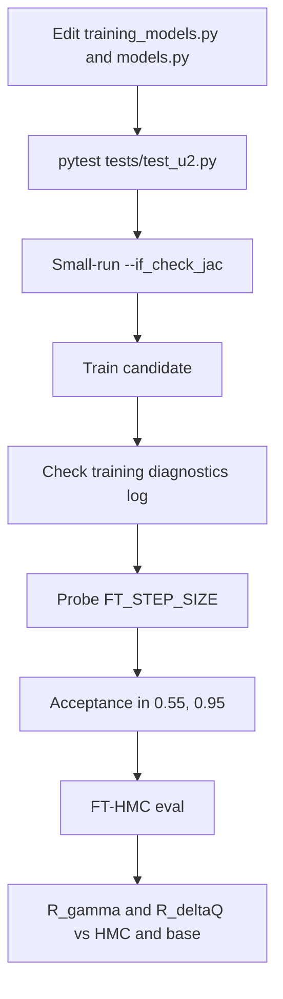

# L=16 U(2) FTHMC Architecture Search Plan

This document is the runbook for fast architecture search on a small lattice before committing to full L=32 production runs. The L=16 **train β=10 `base`** production baseline (gauge → train → HMC/FT-HMC eval) is already in place and analyzed via [`presentation/2du2_scaling.ipynb`](../2du2_scaling.ipynb). Architecture search iterates on CNN design, loss function, and training hyperparameters, ranking candidates against that baseline.

## 1. Goal and non-goals

**Goal:** Find FTHMC field-transformation designs that beat the L=16 train-β=10 `base` model on evaluation metrics **R_gamma(16)** and **R_deltaQ**, after passing all correctness gates.

**Non-goals:**

- L=32 confirmation (separate Phase 4, run only after a winner is chosen on L=16)
- Gauge generation (already available: `2du2/configs/links_L16_beta10.0.npy`)
- Re-running the production HMC / FT-HMC `base` grid (already generated via [`2du2/evaluation/hmc/gen_sub.sh`](../../2du2/evaluation/hmc/gen_sub.sh) and [`2du2/evaluation/base/gen_sub.sh`](../../2du2/evaluation/base/gen_sub.sh))

## 2. Experimental grid

| Parameter | Value |
|-----------|-------|
| Lattice size L | 16 |
| Train β | 10.0 |
| Eval β | 10, 12, 14, 16 |
| `train_beta` at eval | 10.0 |
| HMC / FT-HMC `n_steps` | 10 |
| HMC `n_configs` | 2048 (step size tuned, target accept ~0.70) |
| FT-HMC `n_configs` | 2048 (fixed `ft_step_size=0.10` for production `base`) |
| Training data | `2du2/configs/links_L16_beta10.0.npy` |

- **Primary ranking β:** 10.0 (on-coupling with train β)
- **Secondary β:** 12, 14, 16 (robustness under stronger coupling)
- **HMC baselines:** L=16, β ∈ {10, 12, 14, 16}, 8 seeds (`1029`, `1107`, `1331`, `1984`, `1999`, `2008`, `2017`, `2025`) — dumps under `2du2/evaluation/hmc/dumps/`
- **FT-HMC `base` reference:** same grid, save tags `base_train_b10.0_L16_{seed}` — dumps under `2du2/evaluation/base/dumps/` (32/32 complete)

## 3. Editable vs frozen files

Training is PyTorch; FT-HMC evaluation is JAX. New architecture tags must be registered in **both** model registries.

| File | Status | What may change |
|------|--------|-----------------|
| [`src/nthmc/u2/training_models.py`](../../src/nthmc/u2/training_models.py) | **Editable** | CNN architecture, `NetConfig`, new `model_tag` entries in `choose_model` (training) |
| [`src/nthmc/u2/training.py`](../../src/nthmc/u2/training.py) | **Editable** | Loss function, `hyperparams` defaults, training-side helpers |
| [`src/nthmc/u2/models.py`](../../src/nthmc/u2/models.py) | **Editable (eval mirror)** | JAX twin of any new `model_tag` so `compare_fthmc.py` can load checkpoints |
| [`src/nthmc/u2/field_transform.py`](../../src/nthmc/u2/field_transform.py) | **Mostly frozen** | JAX eval geometry / inverse / force runtime; do not change loop geometry without tests |
| [`2du2/model_training/train.py`](../../2du2/model_training/train.py) | **Editable** | CLI wiring for new hyperparams (e.g. `--align_weight`) |

Training and evaluation imports:

```python
# 2du2/model_training/train.py
from nthmc.u2.training import FieldTransformation

# 2du2/evaluation/*/compare_fthmc.py
from nthmc.u2.field_transform import FieldTransformation  # JAX
```

Before the first architecture edit, snapshot `training_models.py` + `training.py` + `models.py` (git branch or tag) for rollback.

### Allowed optimization surface

**In `training_models.py` (+ JAX `models.py` mirror):**

- New `nn.Module` / JAX model classes and `choose_model` tags
- `NetConfig`: `hidden_channels`, `kernel_size`, depth, multiscale branches
- Coefficient caps, `_LayerScale` / `out_scale` gain
- Registered search tags: **`base`**; D3 aliases **`base_tail`** / **`base_lonly`**; D2 **`cap`** / **`balanced_cap`**; D1/D10 **`res1`** / **`deep`**; D5–D9 **`wide24`**, **`kernel5`**, **`split_input`**, **`dilated2`**, **`rmsnorm`**; D11 **`multiscale`**; D12 **`pointwise`**; D13 **`silu`**; D14 **`phase_multiscale`**; D17 **`layernorm`**

**In `training.py`:**

- `hyperparams` defaults and new keys (passed via CLI in `train.py`)
- `loss_fn` and helpers: `_weighted_force_loss_*`, stubbed topology alignment (~lines 948–954), new regularizers
- Do **not** change core loop/Jacobian geometry unless `tests/test_u2.py` is extended

**Hyperparams wired via CLI** (`2du2/model_training/train.py`):

- `--lr`, `--weight_decay`, `--max_grad_norm`
- `--loss_weights` (4-tuple: w2, w4, w6, w8)
- `--plateau_patience`, `--early_stop_patience`

### Hard constraints on CNN I/O

Enforced in training and eval coefficient paths:

- **Input:** 6 plaquette + 12 rectangle scalar channels per lattice site
- **Output:** 16 plaquette + 32 rectangle coefficient channels (4 slots × loop count)
- Coefficients must stay within tanh caps (reversibility); output gate starts at identity (zero `out_scale` / `_LayerScale`)
- Do **not** change `plaq_loop_count`, `rect_loop_count`, `coeff_slots_per_loop`, or attached-loop geometry without extending Jacobian tests

## 4. Success metrics

Definitions match [`presentation/2du2_scaling.ipynb`](../2du2_scaling.ipynb).

### R_gamma(16)

Integrated autocorrelation time ratio at lag 16 (notebook convention: FT-HMC improvement appears as values **> 1**):

```
A(δ) = 1 - <ΔQ²(δ)> / (2V)        # V = L²
gamma(δ) = 1 / (1 - A(δ))
R_gamma(16) = gamma_HMC(16) / gamma_FT(16)
           = (1 - A_fthmc[16]) / (1 - A_hmc[16])
```

**Better when > 1** (FT-HMC decorrelates topology faster than HMC).

### R_deltaQ

Mean absolute topology step size ratio:

```
deltaQ = mean(|diff(topo)|)
R_deltaQ = <deltaQ>_fthmc / <deltaQ>_hmc
```

**Better when > 1** (FT-HMC takes larger topological steps).

### Analysis settings

- `GAMMA_LAG = 16`, `MAX_LAG = 64`
- Jackknife over seeds (notebook `collect_one`, `average_pair_with_jackknife`)
- Production `base` paths:

```python
HMC_DUMP_DIR = REPO_ROOT / "2du2" / "evaluation" / "hmc" / "dumps"
FTHMC_DUMP_DIR = REPO_ROOT / "2du2" / "evaluation" / "base" / "dumps"
MODEL_TAG = "base"
TRAIN_BETA = 10.0
LATTICE_SIZES = [16]
BETAS = [10.0, 12.0, 14.0, 16.0]
SEEDS = [1029, 1107, 1331, 1984, 1999, 2008, 2017, 2025]
```

For a candidate, point `FTHMC_DUMP_DIR` / `MODEL_TAG` at that candidate's eval folder and tag.

### Win rule

A candidate **beats base** at the same (β, n_steps, seed set) when:

1. **R_gamma(16) > base** and **R_deltaQ > base** at primary eval β=10 (both also > 1 vs HMC), and
2. At least one metric has jackknife error bars that do not overlap base at ≤1σ (soft gate for T1/T2), or
3. At T3: both metrics beat base with ≥3 seeds and clear separation

A candidate that improves only one metric while regressing on the other is **not** promoted unless explicitly documented as a trade-off study.

### Current production `base` reference (2026-08-05)

Computed with the notebook definitions from all eight paired HMC↔FT seeds after retraining `base` with the stable protocol (`lr=2.5e-4`, plateau factor 0.2/patience 0, gradient clip 5, early-stop patience 4). FT-HMC uses fixed `ft_step_size=0.10`.

| Eval β | Seeds paired | R_gamma(16) | R_deltaQ | HMC accept | FT accept |
|--------|--------------|-------------|----------|------------|-----------|
| 10.0 | 8/8 | 1.067(73) | 1.130(44) | 0.676 | 0.951 |
| 12.0 | 8/8 | 0.997(38) | 0.972(25) | 0.789 | 0.941 |
| 14.0 | 8/8 | 0.97(12) | 0.990(80) | 0.674 | 0.930 |
| 16.0 | 8/8 | 1.18(27) | 1.07(27) | 0.757 | 0.900 |

The new curves are substantially more stable than the prior high-LR best-checkpoint base, but these FT-HMC metrics are not better. The old base and candidate measurements remain useful historical diagnostics only; every new candidate must be retrained and compared with this table under the stable protocol.

## 5. Correctness gates

Every candidate must pass all gates before metrics are scored.



| Gate | Command / check | Pass criterion |
|------|-----------------|----------------|
| **G1 Unit tests** | `pytest tests/test_u2.py -k "field_transform"` | All pass (round-trip, Jacobian, gauge covariance as covered) |
| **G2 Jacobian check** | Short train with `--if_check_jac`, L=8 or L=16, 1 epoch, 1 GPU | No Jacobian mismatch errors |
| **G3 Training diagnostics** | Read epoch log from `maybe_log_training_diagnostics` | Inverse convergence OK; saturation fractions not pinned at 1.0 |
| **G3b Loss stability** | Inspect fixed-validation loss and coefficient saturation by epoch | No post-minimum collapse: final/early-stop loss ≤1.05× best, no single-epoch validation increase >5%, and the retained checkpoint is the final accepted checkpoint |
| **G4 Step-size probe** | Short FT-HMC sweep (see Section 8) | Find `ft_step_size` with acceptance ∈ [0.55, 0.95] |
| **G5 Formal eval acceptance** | T1/T2/T3 `compare_fthmc.py` run | Acceptance ∈ [0.55, 0.95] at chosen `FT_STEP_SIZE` |

Skip compile / CUDA-graph heavy paths during step-size probes when they OOM; prefer the production eval env flags already used in `base/gen_sub.sh`.

## 6. Tiered compute budget

| Tier | Purpose | Seeds | n_configs | n_epochs | GPUs |
|------|---------|-------|-----------|----------|------|
| **T0** | Correctness only | — | — | 1 | 1 + `--if_check_jac` |
| **T1** | Fast screen | 1 (`1029`) | 512 | 16 | 4 train / 1 eval |
| **T2** | Rank candidates | 3 (`1029`, `1331`, `1999`) | 1024 | 16 | 4 |
| **T3** | Confirm winner | 8 (full pool) | 2048 | 16 | 4 |

- L=16 **base** production reference is already at **full 8-seed / 2048-config** coverage (treat as the ranking floor)
- T3 only for top 1–2 candidates

### Naming conventions

**Training checkpoints** (`2du2/artifacts/models/`):

```
{model_tag}_train_b10.0_L16_{seed}
best_model_train_beta10.0_{model_tag}_train_b10.0_L16_{seed}.{pt,npz}
```

**Evaluation topology dumps** (`2du2/evaluation/<eval_tag>/dumps/`):

```
topo_fthmc_L16_beta{beta}_nsteps10_{save_tag}.csv
accept_rate_fthmc_L16_beta{beta}_nsteps10_{save_tag}.csv
```

**HMC baselines** (`2du2/evaluation/hmc/dumps/`, from `hmc/gen_sub.sh`):

```
topo_hmc_L16_beta{beta}_nsteps10_{seed}.csv
accept_rate_hmc_L16_beta{beta}_nsteps10_{seed}.csv
```

Seeds: `1029`, `1107`, `1331`, `1984`, `1999`, `2008`, `2017`, `2025`. No additional HMC jobs are required for architecture search.

## 7. Evaluation directories

There is no `add_folder.sh` in the current tree. Create candidate workspaces by copying the canonical [`2du2/evaluation/base/`](../../2du2/evaluation/base/) layout.

### Create a folder

```bash
cd 2du2/evaluation
cp -a base l16_search          # or l16_<model_tag>
# then edit l16_search/gen_sub.sh: model_tag, ft_step_size, paths
```

Keep `compare_fthmc.py` in sync with `evaluation/base/compare_fthmc.py` unless a candidate needs local CLI changes.

| `gen_sub.sh` field | L=16 search value |
|--------------------|-------------------|
| `lattice_size` | 16 |
| `train_beta` | 10.0 |
| `n_steps` | 10 |
| `model_tag` | candidate `model_tag` |
| PBS `-o` / logs | `2du2/evaluation/<eval_tag>/` |
| `ft_step_size` | Set **only after** probe (Section 8); production base used `0.10` |
| `n_configs` | Tier-appropriate (512 / 1024 / 2048) |
| `tune_step_size` | `false` + `--no_tune_step_size` (fixed step from probe) |

### Folder naming

| Folder tag | Purpose | When |
|------------|---------|------|
| `base` | Production train-β=10 base reference (do not overwrite during search) | Phase 1 done |
| `l16_search` | Fast T1/T2 candidate screening | Phase 2 |
| `l16_<model_tag>` | Dedicated folder per promoted candidate | T2/T3 |

HMC baselines stay in `2du2/evaluation/hmc/` (shared). When analyzing candidates in `2du2_scaling.ipynb`, set `FTHMC_DUMP_DIR` / `MODEL_TAG` to the candidate folder and tag; keep `HMC_DUMP_DIR` and `TRAIN_BETA = 10.0`.

## 8. FT_STEP_SIZE probe (mandatory)

**Every** formal FT-HMC run at a new `(model_tag, beta, L)` combination requires a step-size probe first. Do not copy production `base` `FT_STEP_SIZE=0.10` blindly for a new architecture — but use it as the lower starting hint (production accept is already ~0.95).

### Probe procedure

1. Load the trained checkpoint (`save_tag`, `train_beta=10.0`)
2. From the candidate's eval folder, run `compare_fthmc.py` with automatic tuning. The JIT-compiled trajectory accepts `dt` dynamically, so all tuning attempts reuse one compilation:

```bash
cd 2du2/evaluation/l16_search   # or candidate folder
python compare_fthmc.py \
    --lattice_size 16 \
    --train_beta 10.0 \
    --beta 10.0 \
    --n_configs 512 \
    --n_thermalization 200 \
    --n_steps 10 \
    --ft_step_size 0.10 \
    --n_tune_steps 32 \
    --target_acceptance 0.70 \
    --target_tolerance 0.05 \
    --max_tune_attempts 10 \
    --max_lag 64 \
    --rand_seed 1029 \
    --model_tag base \
    --save_tag base_train_b10.0_L16_1029 \
    --device cuda
```

3. Read the final `step_size_*.csv` and `accept_rate_*.csv`; require the 512-config acceptance to land in **[0.55, 0.95]**
4. Record the chosen value in the **step-size log** (Section 12); use it as a fixed step in later T2/T3 runs

**T1 settings:** 32 proposals per binary-search attempt, target acceptance 0.70 ± 0.05, at most 10 attempts, then 200 fixed-step thermalization proposals and a 512-config scoring chain on seed `1029`. `gen_probe_sub.sh` implements this single-process path. A manual fixed-step sweep is only the fallback when the final acceptance misses the gate.

### Initial step-size hints (L=16, train β=10)

| Eval β | Initial `ft_step_size` |
|--------|------------------------|
| 10 | 0.10 |
| 12 | 0.10 |
| 14 | 0.08 |
| 16 | 0.08 |

Production `base` at `ft_step_size=0.10` sits at FT accept ≈ 0.94–0.96 across the grid — often above the upper gate edge. For fair metric comparison, either (a) keep a common step and report accept, or (b) retune each candidate into [0.55, 0.95], choose the probed value closest to the common acceptance target 0.70, and record it. Prefer **(b)** for cross-candidate ranking.

Probe `base` into the same 0.70 target as an additional control. Report every candidate against both the unchanged production chain and this acceptance-matched base chain; otherwise a step-size gain can be mistaken for an architecture gain.

If no value hits the acceptance window, the candidate is **not ready for metric comparison** — adjust the transform or training, then re-probe.

## 9. Phase-by-phase workflow


### Phase 0 — Setup

- [x] Generate `2du2/configs/links_L16_beta10.0.npy`
- [x] L=16 HMC baselines at eval β ∈ {10, 12, 14, 16} via `evaluation/hmc/gen_sub.sh` (8 seeds)
- [x] Production eval workspace: `evaluation/base/` + `gen_sub.sh`
- [x] Git branch/tag snapshot of `training_models.py` + `training.py` + `models.py` before first search edit (`l16-d3-search`)

### Phase 1 — L=16 base reference

- [x] Train `model_tag=base` on L=16 β=10 with the stable protocol (32-epoch ceiling, early stops at epochs 14–16, 8 seeds)
- [x] Production FT-HMC in `evaluation/base/` at all eval βs (`ft_step_size=0.10`, 2048 configs, 8 seeds)
- [x] Record the final eight-seed baseline **R_gamma(16)** and **R_deltaQ** table (Section 4)

### Phase 2 — Agent search loop

See Section 11. Use `l16_search/` (or per-candidate folders). Compare every candidate against Phase 1 baseline.

Status on 2026-07-29: all original seed-1029 T1 evaluations are complete. Under the old `lr=1e-3` best-checkpoint protocol, `rmsnorm` and parameter-matched `multiscale` are the two-metric one-seed leads, while `split_input` and `dilated2` are promoted topology-oriented trade-offs. Added-seed evaluation now gives valid two-seed evidence for `rmsnorm` and `split_input`; `dilated2` has three valid seeds and beats the production base by `R_gamma` 0.295(91) and `R_deltaQ` 0.238(81). `rmsnorm` seed 1999 missed G5 with final acceptance 0.521 and is being rerun at a lower initial step as job 169813. The first LR-probe submissions 169683–169685 did not train: all exited at the GPU isolation preflight when PBS exposed all eight physical devices for a four-GPU quad. The generator now deterministically maps `exec_host` chunk 0/1 to GPUs 0–3/4–7 when that cgroup failure occurs. The corrected base seed-1029 probes at `lr={1e-4,2.5e-4,5e-4}` are jobs 169810–169812; the stability search was expanded with seed-1029 boundary probes at `5e-5`/`7.5e-4` (169814–169815), seeds 1331/1999 for each core LR (169816–169821), and seed-1029 near-constant-LR controls at `1e-4`/`2.5e-4` (169822–169823). All use `by-gpu` four-GPU quads. This separates initial-LR, seed, and plateau-scheduler effects before changing defaults. Final `base` and promoted architectures must still be retrained under the selected stable schedule and pass G3b before T3.

First completed seed-1029 LR sweep: `5e-5` and `1e-4` decrease monotonically through epoch 16, ending at validation losses 36.625 and 33.073 with zero coefficient saturation, but neither has converged. `2.5e-4` reaches 28.352 at epoch 10 and then ends at 30.204 (+6.53%) with central/traceless saturation 10.4%/5.4%, narrowly failing G3b. `5e-4` reaches 27.295 at epoch 6 and rebounds +24.45% with 34.5%/30.1% saturation; `7.5e-4` reaches 26.725 at epoch 4 and rebounds +31.52% with 39.8%/39.9% saturation. Thus the current evidence brackets the stable useful initial LR between `1e-4` and `2.5e-4`; a monotone but undertrained `1e-4` run is not by itself sufficient to set the default. Added-seed runs and scheduler controls must determine whether a mid-range LR or earlier decay preserves the low loss without saturation.

Architecture training remains paused until the base training protocol is fixed. The second controlled sweep extends `1e-4` to at most 48 epochs (169879, six-hour walltime) to locate its actual plateau/saturation point, fills the LR gap with `1.5e-4` for at most 40 epochs (169874) and `2e-4` for at most 32 epochs (169875), and tests immediate plateau response (`patience=0`) at `2e-4`/`2.5e-4` (169876–169877). Job 169878 changes only the `2.5e-4` plateau factor from 0.5 to 0.2. All retain base, seed 1029, batch, clipping, data, and `by-gpu` four-GPU allocation. Early stopping selects the effective epoch count; the maximum epoch is only a ceiling. The original four-hour job 169873 was cancelled before execution because inverse iterations were already increasing nonlinearly by epoch 16 and the scheduler rejected an in-place walltime change.

Completed scheduler comparison on seed 1029: `1.5e-4` reaches 29.215 at epoch 16 and stops at epoch 20 with a 2.92% rebound and 5.3%/1.2% central/traceless saturation. `2e-4` reaches 28.668 at epoch 13; changing plateau patience 1 → 0 improves the terminal rebound from 6.59% to 3.24% and reduces terminal saturation from 10.9%/6.3% to 6.1%/1.5%. At `2.5e-4`, patience 0 with factor 0.5 gives a 2.16% rebound and 3.4%/0.6% saturation, while factor 0.2 gives only a 0.69% rebound, a maximum one-epoch increase of 0.32%, and 0.4%/0.0% saturation, without changing the best loss 28.352. The factor-0.2 schedule is therefore the provisional winner. The ordinary `2.5e-4` schedule fails consistently across seeds 1029/1331/1999 with 6.53%/9.95%/10.16% rebounds, and `5e-4` fails with 21–24% rebounds across the same seeds.

Jobs 169816 (`1e-4`, seed 1331) and 169879 (`1e-4`, 48 epochs) produced no training data: two four-GPU jobs were placed concurrently on `sophia-gpu-05`, and each distributed rank attempted to create a full OpenMP thread pool, causing `libgomp: Thread creation failed`. The generator now pins OpenMP/MKL/OpenBLAS/NumExpr to one thread per rank. The long `1e-4` diagnostic and missing seed were resubmitted as 170151–170152; provisional-winner confirmations at seeds 1331/1999 are 170153–170154. Do not change defaults or resume architecture training until these four jobs complete.

Update on 2026-08-01: the corrected long `1e-4` run reaches its minimum 29.716 only at epoch 23, then early-stops at epoch 27 with a 1.21% rebound and 2.0%/0.3% saturation. This confirms that the apparently monotone 16-epoch curve was undertrained and that `1e-4` is slower and has a worse minimum than the selected schedule. The eight-seed production jobs 170181–170188 all pass G3b: best epochs 10–12, stops at 14–16, terminal rebounds 0.69%–4.64%, maximum one-epoch increases 0.32%–3.62%, and terminal central/traceless saturation at most 1.7%/0.1%. U(2) defaults are `lr=2.5e-4`, `ReduceLROnPlateau(factor=0.2, patience=0)`, `max_grad_norm=5`, `early_stop_patience=4`, and a 32-epoch ceiling. The stability improvement trades against absolute best loss: the eight-seed median best validation loss is about 28.29 versus 26.91 under the old high-LR best-checkpoint protocol, so FT-HMC evaluation—not the tail shape alone—must decide whether this is the better base.

The per-seed four-beta held jobs 170189–170196 were deleted before execution because the explicit user hold remained after their dependencies completed and single-run jobs are preferred. Of the first 20 independent evaluations, 17 completed successfully. Beta-10 seed 2008 (170343), beta-12 seed 1331 (170348), and beta-14 seed 1984 (170357) exited before replacing their older production dumps. On 2026-08-04 these three combinations and all 12 remaining beta-14/beta-16 combinations were submitted as 15 independent, unheld `by-gpu` jobs 170897–170911. All 15 completed successfully. The regenerated 32-combination grid passed the 2048-sample, finite-value, acceptance, and fixed-step validation, and its final metrics are recorded in Section 4.

Reset on 2026-08-05: after preserving this runbook and its historical evidence, the existing architecture implementation and search workspace were deliberately abandoned. The repository returns to the optimized-protocol `base` model only. Candidate rows below document hypotheses and prior observations, not current promotion evidence; future architecture search must reimplement isolated features and retrain/re-evaluate them against the new base.

The corrected `rmsnorm` seed-1999 evaluation completed with step 0.184375 and acceptance 0.748, passing G5. Across three seeds, `rmsnorm` gives `R_gamma=1.30(28)` versus base `1.06(17)` (difference `0.24(21)`) and `R_deltaQ=1.480(40)` versus `1.181(62)` (difference `0.299(43)`). The topology improvement is now clear, while the autocorrelation improvement is positive but not statistically resolved after adding the third seed.

### Phase 3 — Confirm winner

- [ ] T3 eval for top 1–2 candidates in dedicated eval folder
- [ ] All eval βs, 8 seeds, 2048 configs
- [ ] Both R_gamma(16) and R_deltaQ beat `base` at β=10 with ≥3 seeds

### Phase 4 — L=32 transfer (optional)

- [ ] Retrain winner on L=32 β=10 with current training stack
- [ ] Eval at stronger couplings using a copied `evaluation/<tag>/` pipeline
- [ ] Keep Torch train / JAX eval registries in sync

## 10. Optimization directions (candidate families)

The search directions below target distinct mechanisms so results stay interpretable. Search each direction on its own; only combine features after each has been validated alone.

| Dir | Lever | Primary file | New `model_tag` / flag | Targets | Cost |
|-----|-------|--------------|------------------------|---------|------|
| D1 | Receptive field / multiscale | [`training_models.py`](../../src/nthmc/u2/training_models.py) + JAX [`models.py`](../../src/nthmc/u2/models.py) | new tag (e.g. `deep`) | R_gamma(16) | T1 (heavier) |
| D2 | Coefficient-budget split | same | `balanced_cap` (`cap` is aggressive failure probe) | R_deltaQ | cheap T1 |
| D3 | Force-tail loss shaping | [`train.py`](../../2du2/model_training/train.py) CLI | `--loss_weights` (no model edit) | acceptance → R_gamma | cheapest |
| D4 | Topology-directed loss | [`training.py`](../../src/nthmc/u2/training.py) | `--align_weight` (new CLI) | R_gamma & R_deltaQ | T1 |
| D5 | Hidden width | model registries | `wide24` | capacity | T1 (heavier) |
| D6 | Dense larger kernel | model registries | `kernel5` | receptive field | T1 (heavier) |
| D7 | Separate feature encoders | model registries | `split_input` | input specialization | T1 |
| D8 | Dilated output convolution | model registries | `dilated2` | sparse receptive field | T1 |
| D9 | Parameter-free hidden RMS norm | model registries | `rmsnorm` | scale stability | T1 |
| D10 | Residual depth | model registries | `res1` vs `deep` | nonlinear spatial depth | T1 |
| D11 | Shared-weight multiscale output | model registries | `multiscale` | mixed local/nonlocal RF | T1 |
| D12 | Pointwise residual depth | model registries | `pointwise` | channel nonlinearity at fixed RF | T1 |
| D13 | Hidden activation | model registries | `silu` | activation shape at fixed architecture | T1 |
| D14 | Determinant-sector multiscale | model registries | `phase_multiscale` | long-range central-phase update | parameter-matched T1 queued |
| D15 | Winding-scale determinant RF | model registries | proposed `phase_multiscale4` | larger-support central-phase update | parameter-matched T1 |
| D16 | Axial determinant RF | model registries | proposed `phase_axial4` | boundary-coherent central-phase update | parameter-matched T1 |
| D17 | Centered hidden normalization | model registries | `layernorm` | RMS scale vs mean centering | parameter-matched T1 queued |

### D1 — Long-range / multiscale receptive field

- **Hypothesis:** topological barriers correlate over distances larger than the base receptive field (`LocalNet` 3×3×2 conv ≈ 5 sites). A larger effective RF lets the transform reshape the action across the whole tunneling region.
- **Mechanism:** spatial expressivity.
- **Change:** add a new model class + `choose_model` tag in **both** Torch and JAX registries — residual stack of circular 3×3 convs (depth 3–4), optionally a dilation pyramid. Reuse split heads, tanh caps, GELU, and zero-init output gate so it still starts at identity.
- **Risk:** at L=16 a too-large RF wraps the torus and over-smooths; watch G3 saturation and inverse convergence.

### D2 — Coefficient-budget split

- **Hypothesis:** the base caps (plaq `tanh/5 = 0.2`, rect `tanh/40 = 0.025`) may be too conservative or mis-balanced; a stronger but still reversible transform takes larger topological steps.
- **Mechanism:** output parametrization (transform magnitude).
- **Change:** `balanced_cap` keeps the base backbone and reallocates 90% of the derived budget to a 50/50 plaquette/rectangle split (`c_plaq=0.1125`, `c_rect=0.05625`). The separately retained aggressive `cap` (`0.4`, `0.05`) is a failure probe: it exceeded the historical budget, raised inverse iterations, and OOMed after epoch 1.
- **Risk:** too-large caps degrade inverse-iteration convergence (G3) and acceptance (G4/G5).

### D3 — Force-tail loss shaping (CLI-only)

- **Hypothesis:** acceptance at a fixed `ft_step_size` is limited by the worst-case forces, not the mean. Up-weighting the higher-order norms (L6/L8 in `_weighted_force_loss_*`) flattens the force tail, allowing a larger usable step size and faster topology mixing.
- **Mechanism:** loss objective (tail control); no model-code edit.
- **Change:** sweep `--loss_weights` (e.g. `1 1 1 1` baseline vs `0.5 1 1.5 2` tail-heavy vs `0 0 1 1` tail-only) together with `--lr`, `--weight_decay`, `--max_grad_norm`. Applies to any `model_tag`.
- **Risk:** over-weighting the tail destabilizes training; watch grad norm and test loss vs base at the same tier.

### D4 — Topology-directed loss term

- **Hypothesis:** minimizing the force norm only indirectly helps topology. Explicitly aligning the transformed force with the soft-topology gradient steers MD trajectories along topology-changing directions — a direct proxy for the goal metrics.
- **Mechanism:** loss objective (topology-directed).
- **Change:** re-enable the stubbed path in `training.py` `loss_fn` (commented near the `_force_topology_alignment_loss` call) using `compute_transformed_force_and_topology_grad`; add an `align_weight` hyperparam key (default `0.0`, so base behavior is unchanged) and a matching `--align_weight` CLI flag in `train.py`. Optionally tune `second_harmonic` in `_soft_topology_from_plaquettes`.
- **Gate note:** training-only path (no Jacobian change → G2 unaffected), but extend `tests/test_u2.py` (G1) to cover the new loss branch.
- **Risk:** the competing objective can raise the force norm and lower acceptance; tune `align_weight` against R_deltaQ / acceptance.

### D5–D9 — Controlled architecture ablations

- `wide24` changes only hidden width (12 → 24), separating raw capacity from spatial range.
- `kernel5` changes only both convolution kernels (3×3 → 5×5), giving RF≈9 without residual depth.
- `split_input` gives plaquette and rectangle channels separate nonlinear encoders before a learned 1×1 fusion.
- `dilated2` keeps base parameter count and changes only the output 3×3 convolution to dilation 2.
- `rmsnorm` keeps the base convolutions/caps and adds only parameter-free per-site channel RMS normalization.
- `res1` uses one residual mid-block (RF≈7), isolating residual depth from `deep` with two blocks (RF≈9).

All six retain the zero-initialized output gate and base coefficient caps. Compare `deep`, `kernel5`, and `dilated2` to distinguish nonlinear depth, dense RF, and sparse RF rather than combining them prematurely.

### D11 — Parameter-matched multiscale

`multiscale` evaluates the base output kernel at dilation 1 and dilation 2 and averages the two logits. The two paths share weights, so this changes only the spatial sampling pattern: parameter count, hidden width, depth, caps, and output gate all remain identical to `base`. This isolates the multiscale part of the historically strong `mscap` combination before reintroducing a cap change.

### D12 — Pointwise residual depth

`pointwise` inserts one residual 1×1 hidden convolution between the base 3×3 input and output convolutions. It keeps the base RF≈5, width, caps, input representation, and output gate, while increasing a single subset from 7,236 to 7,392 parameters (+2.2%). Compare it with `res1`: any common gain points to nonlinear/channel depth, while an additional `res1` gain isolates the larger spatial RF.

### D13 — Hidden activation

`silu` replaces only the base GELU with SiLU. It is exactly parameter-matched to `base` (7,236 parameters per subset) and leaves RF, width, caps, input representation, convolution initialization, and output gate unchanged. This tests whether the smooth self-gated activation improves force fitting independently of capacity or spatial range.

### D17 — Centered normalization control

`layernorm` starts from `rmsnorm` and changes only the parameter-free per-site channel statistic: it subtracts the channel mean before normalizing the centered RMS. It keeps the base parameter tree/count, receptive field, activation, caps, input path, and output gate. Compare it directly with `rmsnorm` to determine whether the normalization lead comes from scale stabilization alone or also benefits from removing the hidden-channel mean.

### D14–D16 — Winding-inspired determinant-sector branches

The motivation comes from Albandea et al., [*Topological sampling through windings*](./2106.14234v4.pdf), arXiv:2106.14234v4. Their reversible proposal distributes a unit winding around the boundary of a square region. In the 2D pure U(1) theory, only boundary plaquettes change and the mean action cost behaves approximately as

```text
<Delta S> ~= beta * pi^2 / Lw ,
```

so winding acceptance improves as the support size `Lw` grows. Alternating these symmetric Metropolis winding proposals with HMC changes the observed topological autocorrelation scaling from exponential in beta to a much milder power law. The paper also reports that a naive extension to 4D SU(2) has very poor acceptance and suggests flow-like deformations as the remedy.

The relevant U(2) mapping is unusually clean in this repository:

- `topology_from_field` uses only the wrapped determinant phase `arg(det P)`;
- coefficient slots `0` and `2` in each four-slot loop block drive the central U(1) phase;
- slots `1` and `3` drive the traceless SU(2) algebra components.

This suggests giving **only the determinant/central-phase slots** a coherent long-range path. Applying the same path to all four slots, as `multiscale` does, may spend model freedom on the SU(2) sector without helping topology and may unnecessarily raise the action cost.

#### D14 — `phase_multiscale`

Use the existing shared `conv_output` kernel at dilations 1 and 2. Average the two logits only for slots `0/2` after reshaping each plaquette/rectangle head as `(n_loops, 4)`; keep slots `1/3` equal to the dilation-1 base logits.

- **Changes:** determinant-sector spatial sampling only.
- **Fixed:** parameter tree/count, hidden representation, caps, gate, activation, and traceless path.
- **Controls:** `base` vs `phase_multiscale` isolates central-phase range; `phase_multiscale` vs `multiscale` isolates whether long-range SU(2) updates help or hurt.
- **Priority:** highest paper-inspired candidate because it is parameter-matched and directly tests the topology-carrying sector.

#### D15 — `phase_multiscale4`

Average shared-kernel dilations `{1, 2, 4}` for slots `0/2`, while slots `1/3` remain local. On L=16, dilation 4 gives central-phase logits support across an approximately 11-site span after the input 3x3 convolution.

- **Changes:** only the maximum central-phase support relative to D14.
- **Control:** compare directly with `phase_multiscale`; do not simultaneously change caps or width.
- **Transfer rule:** if promoted to L=32, first test a dilation that preserves the fractional reach (candidate `d=8`) rather than silently retaining the L=16 lattice-unit range.
- **Risk:** periodic wraparound or over-smoothing can reduce useful local variation even when the force loss improves.

#### D16 — `phase_axial4`

For slots `0/2`, average the local output with the same shared 3x3 kernel evaluated at anisotropic dilations `(4, 1)` and `(1, 4)`; keep slots `1/3` local. This creates elongated periodic support along the two lattice axes, closer to a distributed square-boundary winding than an isotropic `(4, 4)` stencil.

- **Changes:** axial versus isotropic geometry only.
- **Control:** compare with D15 at the same maximum displacement and identical parameter tree.
- **Risk:** the fixed axial prior may be too restrictive for configurations whose low-action topology-changing path is not axis-aligned.

For all D14–D16 candidates, combine branch logits **before** `_LayerScale` and `tanh`, keep the current coefficient caps, and use distinct model tags even though the parameter tree matches `base`. Each must pass Torch/JAX forward parity and the nontrivial full-field Jacobian test because the spatial dependency pattern changes.

Do not combine these branches with `balanced_cap`, `wide24`, or a new loss in the first pass. If a determinant-selective branch wins independently, the first controlled combination should be that winner plus `balanced_cap`, motivated by the historically strong but confounded `mscap` result.

#### Winding-specific diagnostics

The paper also motivates diagnostics more targeted than test loss:

- record `mean(|Delta Q| >= 1)` and `mean(|Delta Q|)` per accepted trajectory;
- report central and traceless update RMS separately (`delta[..., 0]` versus `delta[..., 1:4]`);
- report topology-changing trajectories per steady-state evaluation second, so a wider/deeper winner must justify its runtime;
- compare plaquette averages conditioned on rounded `Q` across HMC, tuned base, and candidates. Fixed-sector agreement does not replace the global topology metrics, but it distinguishes local within-sector sampling from correct sector motion.

#### Separate algorithmic control, not an architecture result

A literal central-U(1) winding Metropolis step may be useful for the current 2D pure-gauge U(2) system: choose winding/antiwinding and the square origin symmetrically, apply the winding only in the determinant sector, accept with the exact U(2) action difference, and alternate with ordinary HMC for ergodicity. This would be a **separate sampler baseline**, not a `models.py` optimization and not part of the architecture ranking. Before implementation, derive the factor-of-two normalization between the stored central phase and `arg(det U)`, and test proposal reversibility, detailed balance, and `Delta Q = +/-1`. Do not naively wind the traceless SU(2) sector: the paper's non-Abelian higher-dimensional trial is specifically a negative acceptance result.

### Paper-driven follow-up order

1. Finish the already queued independent `multiscale`, `dilated2`, `deep`, and other T1 screens.
2. Run `phase_multiscale` regardless of whether full `multiscale` wins: their difference identifies the contribution from the traceless long-range path.
3. Run `phase_multiscale4` only after D14, isolating winding support size.
4. Run `phase_axial4` only if D14/D15 show a useful determinant-sector long-range signal.
5. Only then test one winning determinant branch plus `balanced_cap`.

## 11. Agent iteration loop

For each candidate `model_tag`:

1. **Implement** in `training_models.py` **and** mirror in JAX `models.py` (+ register in both `choose_model`s)
2. **Optionally tune** `loss_fn` / `hyperparams` in `training.py`
3. **T0 gates:** `pytest` + `--if_check_jac` short run
4. **Train** at appropriate tier (T1 screen → T2 if promising)
5. **Eval folder:** copy `evaluation/base/` → candidate folder; adapt `gen_sub.sh`
6. **Probe `FT_STEP_SIZE`** at β=10 first, then per-β before T2/T3
7. **FT-HMC eval** only after acceptance OK
8. **Compute** R_gamma(16), R_deltaQ vs HMC, production `base`, and the acceptance-matched `base` control
9. **Promote** to T2/T3 if metrics beat baseline
10. **Log** in tables below (include probed `FT_STEP_SIZE`)

### Suggested search order (cheap → expressive)

1. **D3** (force-tail loss shaping) — CLI-only sweep on `base`; establishes how much acceptance headroom comes from the loss alone.
2. **D2** (caps + gate gain) — cheap forward-path tags; reintroduce as needed.
3. **D1** (receptive field / multiscale) — new architecture tag; heavier, run after D2/D3 narrow the loss + caps.
4. **D4** (topology-directed loss) — objective experiment; layer on the best D1–D3 configuration once each is validated alone.

### Promotion criteria (T1 → T2)

- Passes G1–G5 at β=10
- Test loss not divergent vs base at same tier
- R_gamma(16) or R_deltaQ beats both production `base` and acceptance-matched `base` at β=10, without regression >10% on the other metric

### Promotion criteria (T2 → T3)

- Both R_gamma(16) and R_deltaQ beat `base` at β=10 (3 seeds)
- Acceptance OK at β=12 and β=14

## 12. Result logging templates

Maintain these tables in this file (append rows) or in a companion `optimization_log.md`.

Older train-β=8 / `l16_*` / `wide|cap|mscap` search rows are **superseded** by the train-β=10 production baseline below and are not carried forward.

### Step-size log

| model_tag | beta | ft_step_size | accept_rate | n_configs | seed pool | pass | notes |
|-----------|------|--------------|-------------|-----------|-----------|------|-------|
| base | 10.0 | 0.10 | 0.963 | 2048 | 8 seeds | yes* | production; accept above 0.95 soft edge |
| base | 12.0 | 0.10 | 0.951 | 2048 | 8 seeds | borderline | production |
| base | 14.0 | 0.10 | 0.948 | 2048 | 8 seeds | yes | production |
| base | 16.0 | 0.10 | 0.941 | 2048 | 8 seeds | yes | production |
| base_tail | 10.0 | 0.16 | 0.564 | 512 | 1029 | yes | T1; tail-heavy force loss |
| base_lonly | 10.0 | 0.16 | 0.586 | 512 | 1029 | yes | T1; L6/L8-only force loss |
| deep | 10.0 | 0.10 | 0.711 | 512 | 1029 | yes | T1; two residual mid-blocks |
| base | 10.0 | 0.1984375 | 0.625 | 512 | 1029 | yes | acceptance-matched search control |
| wide24 | 10.0 | 0.1703125 | 0.668 | 512 | 1029 | yes | T1; hidden width 12 → 24 |
| split_input | 10.0 | 0.1703125 | 0.730 | 512 | 1029 | yes | T1; separate plaquette/rectangle encoders |
| dilated2 | 10.0 | 0.184375 | 0.717 | 512 | 1029 | yes | T1; dilation-2 output convolution |
| res1 | 10.0 | 0.1333984 | 0.602 | 512 | 1029 | yes | T1; one residual spatial block |
| kernel5 | 10.0 | 0.1703125 | 0.707 | 512 | 1029 | yes | T1; dense 5×5 kernels |
| rmsnorm | 10.0 | 0.15625 | 0.879 | 512 | 1029 | yes | T1; parameter-free hidden RMS normalization |
| deep | 10.0 | 0.1632812 | 0.703 | 512 | 1029 | yes | matched-protocol T1; two residual spatial blocks |
| balanced_cap | 10.0 | 0.15625 | 0.615 | 512 | 1029 | yes | T1; 90%-budget balanced caps |
| multiscale | 10.0 | 0.184375 | 0.662 | 512 | 1029 | yes | T1; shared output kernel at dilation 1/2 |
| pointwise | 10.0 | 0.15625 | 0.742 | 512 | 1029 | yes | T1; residual 1×1 hidden layer |
| silu | 10.0 | 0.1773438 | 0.752 | 512 | 1029 | yes | T1; activation-only ablation |

\*Production `base` intentionally kept at a common `ft_step_size=0.10` for the scaling notebook. New candidates should probe into [0.55, 0.95].

### Results log

| run_id | eval_tag | model_tag | ft_step_size | accept β=10 | R_gamma(16) β=10 | R_deltaQ β=10 | R_gamma β=12 | R_deltaQ β=12 | R_gamma β=14 | R_deltaQ β=14 | R_gamma β=16 | R_deltaQ β=16 | notes |
|--------|----------|-----------|--------------|-------------|------------------|---------------|--------------|---------------|--------------|---------------|--------------|---------------|-------|
| base_ref | base | base | 0.10 | 0.951 | 1.067(73) | 1.130(44) | 0.997(38) | 0.972(25) | 0.97(12) | 0.990(80) | 1.18(27) | 1.07(27) | stable training protocol; 8 seeds and 2048 configs at every β |
| base_ref_old_lr | base | base | 0.10 | 0.963 | 1.124(78) | 1.189(48) | 1.017(48) | 0.959(46) | 1.091(66) | 1.165(91) | 1.45(33) | 1.32(33) | historical high-LR best-checkpoint base; not the current comparison baseline |
| base_tail_t1 | l16_search | base_tail | 0.16 | 0.564 | 1.122 | 1.298 | — | — | — | — | — | — | seed 1029, 512 configs; R_gamma regresses vs matched-seed base |
| base_lonly_t1 | l16_search | base_lonly | 0.16 | 0.586 | 1.164 | 1.143 | — | — | — | — | — | — | seed 1029, 512 configs; both metrics regress vs matched-seed base |
| deep_t1_prelim | l16_search | deep | 0.10 | 0.711 | 1.365 | 1.248 | — | — | — | — | — | — | seed 1029, 512 configs; global batch 64 vs base 256, so treated only as a positive lead and rerun under the matched protocol |
| base_tuned_t1 | l16_search | base | 0.1984375 | 0.625 | 1.754 | 1.204 | — | — | — | — | — | — | seed 1029, 512 configs; acceptance-matched search control |
| wide24_t1 | l16_search | wide24 | 0.1703125 | 0.668 | 1.514 | 1.415 | — | — | — | — | — | — | seed 1029, 512 configs; vs tuned base R_gamma −13.7%, R_deltaQ +17.5%, so retain only as a documented trade-off |
| split_input_t1 | l16_search | split_input | 0.1703125 | 0.730 | 1.695 | 1.492 | — | — | — | — | — | — | seed 1029, 512 configs; vs tuned base R_gamma −3.4%, R_deltaQ +24.0%; promote to T2 |
| dilated2_t1 | l16_search | dilated2 | 0.184375 | 0.717 | 1.743 | 1.426 | — | — | — | — | — | — | seed 1029, 512 configs; vs tuned base R_gamma −0.7%, R_deltaQ +18.4%; promote to T2 |
| res1_t1 | l16_search | res1 | 0.1333984 | 0.602 | 1.208 | 1.193 | — | — | — | — | — | — | seed 1029, 512 configs; vs tuned base R_gamma −31.2%, R_deltaQ −0.9%; reject |
| kernel5_t1 | l16_search | kernel5 | 0.1703125 | 0.707 | 1.172 | 1.320 | — | — | — | — | — | — | seed 1029, 512 configs; vs tuned base R_gamma −33.2%, R_deltaQ +9.7%; reject |
| rmsnorm_t1 | l16_search | rmsnorm | 0.15625 | 0.879 | 1.832 | 1.470 | — | — | — | — | — | — | seed 1029, 512 configs; vs tuned base R_gamma +4.4%, R_deltaQ +22.1%; strongest T1 lead, promote to T2 |
| deep_t1 | l16_search | deep | 0.1632812 | 0.703 | 1.069 | 1.315 | — | — | — | — | — | — | matched production training protocol; vs tuned base R_gamma −39.1%, R_deltaQ +9.2%; reject |
| balanced_cap_t1 | l16_search | balanced_cap | 0.15625 | 0.615 | 1.481 | 1.198 | — | — | — | — | — | — | seed 1029, 512 configs; vs tuned base R_gamma −15.6%, R_deltaQ −0.5%; reject |
| multiscale_t1 | l16_search | multiscale | 0.184375 | 0.662 | 1.783 | 1.376 | — | — | — | — | — | — | seed 1029, 512 configs; vs tuned base R_gamma +1.7%, R_deltaQ +14.3%; promote to T2 |
| pointwise_t1 | l16_search | pointwise | 0.15625 | 0.742 | 1.055 | 1.365 | — | — | — | — | — | — | seed 1029, 512 configs; vs tuned base R_gamma −39.8%, R_deltaQ +13.4%; reject |
| silu_t1 | l16_search | silu | 0.1773438 | 0.752 | 1.440 | 1.409 | — | — | — | — | — | — | seed 1029, 512 configs; vs tuned base R_gamma −17.9%, R_deltaQ +17.0%; reject |
| cap_train_failure | — | cap | — | — | — | — | — | — | — | — | — | — | aggressive caps use budget 2.0; epoch-1 inverse mean/max iterations 26.2/67, test loss 53.47, then OOM; rejected before eval |

Add candidate rows below as search proceeds.

## 13. Pitfalls

- **Torch/JAX dual registry:** a new `model_tag` in `training_models.py` without a JAX twin in `models.py` trains but cannot evaluate
- **L=16 receptive field:** base 3×3×2 conv has RF=5 sites ≈ 31% of L — locality changes may behave differently than at L=32 (16%)
- **Coupling grid:** train β=10, eval β≥10; poor high-β robustness is a failure mode, not noise
- **Skipping FT_STEP_SIZE probe** invalidates cross-candidate comparison
- **Do not overwrite `evaluation/base/` dumps** during search — copy to a new folder
- **Checkpoint incompatibility** across architecture changes — always use a new `save_tag`
- **`inf` ratios:** when HMC autocorrelation at lag 16 ≈ 1, R_gamma diverges (see notebook `gamma_ratio_from_autocorrelations`)
- **High base accept at step 0.10:** retuning candidates to a lower accept (larger step) may change the fair comparison vs the published `base_ref` table — document the choice
- **Literature transfer:** the winding result is evidence for 2D U(1), not proof that D14–D16 improve U(2); the paper's poor naive SU(2) acceptance is why determinant selectivity and the normal G1–G5/T1 gates are mandatory

## 14. Quick reference commands

### Training (T2 example)

```bash
cd 2du2/model_training
torchrun --standalone --nproc_per_node=4 train.py \
    --lattice_size 16 --min_beta 10.0 --max_beta 10.0 --beta_gap 0.5 \
    --n_epochs 16 --batch_size 64 --n_subsets 8 \
    --model_tag base --save_tag base_train_b10.0_L16_1029 --rand_seed 1029 \
    --lr 1e-3 --max_grad_norm 5 \
    --plateau_patience 2 --early_stop_patience 5 \
    --loss_weights 1 1 1 1 \
    --data_parallel
```

### Correctness (T0)

```bash
pytest tests/test_u2.py -k "field_transform"
```

### Analyze results (notebook)

Adapt the constants in `presentation/2du2_scaling.ipynb` as listed in Section 4 / Section 7 (`HMC_DUMP_DIR`, `FTHMC_DUMP_DIR`, `MODEL_TAG`, `TRAIN_BETA`, `LATTICE_SIZES`, `BETAS`, `SEEDS`).
